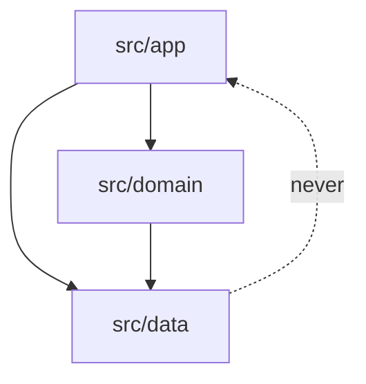
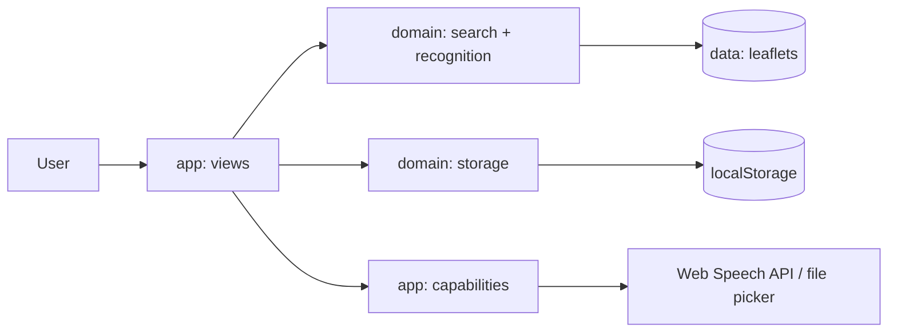

# Architecture Spine — GI 4.0 Prototype

## Design Paradigm

**Layered static client.** Three layers, one direction of dependency:

| Layer | Directory | Holds |
| --- | --- | --- |
| data | `src/data/` | Leaflet records and static page content as plain data |
| domain | `src/domain/` | Pure functions and the storage wrapper: search, matching, leaflet helpers, validation, history/requests |
| app | `src/app/` | DOM rendering, routing, browser capabilities, event wiring |

The Figma tech-ecosystem frame (website for phone, tablet, computer; no login; AI only for speech and photo; local recent searches; approved leaflets from the database) is the source of the paradigm. The "database", "AI" and "email service" boxes of the Figma flow are represented here by data modules and simulated adapters.

## Invariants & Rules



### AD-1 — Dependency direction
- **Binds:** all
- **Prevents:** domain logic that cannot be unit-tested because it reaches into the DOM
- **Rule:** `domain` and `data` import nothing from `app` and never touch `document`/`window` directly; `storage.js` takes the storage object as a parameter (defaults to `localStorage` only at its call site in `app`).

### AD-2 — Local-only persistence [ADOPTED]
- **Binds:** FR-10, FR-11
- **Prevents:** personal data leaking to a server, undeletable history
- **Rule:** user data (history, requests, email) lives only in `localStorage` under keys `pps_history` and `pps_requests`, read and written only through `src/domain/storage.js`. Every read/write is wrapped in try/catch and the app works with storage unavailable. No cookies, no network calls, no analytics.

### AD-3 — Verbatim leaflets [ADOPTED]
- **Binds:** FR-6, FR-7
- **Prevents:** altered or machine-translated medical text
- **Rule:** leaflet text is rendered exactly as stored (HTML-escaped, nothing else). No function may summarise, translate, reorder, shorten or reword it. Sections are shown in the leaflet's own order (`sectionKeys`); the critical ones are only highlighted (`isCritical`). Tests open every sample leaflet in both interface languages and compare the text on screen with the source. German leaflets carry `lang: 'de'` and keep it for audio.

### AD-4 — Capabilities behind one module
- **Binds:** FR-2, FR-3, FR-4, FR-7
- **Prevents:** features that crash where mic, camera, speech or print are blocked
- **Rule:** `src/app/capabilities.js` exposes `listen()`, `speak()`, `stopSpeaking()`, `pickPhoto()`; each feature-detects, resolves with a typed result or a reason, and the UI always offers a text alternative. Voice and audio are never the only way to do something.

### AD-5 — Design tokens only
- **Binds:** FR-13
- **Prevents:** colours or fonts hard-coded per component
- **Rule:** every colour in `src/styles.css` is a CSS custom property defined on `:root` (a single light theme, `color-scheme: light`); no literal colour in a component rule except the white-on-brand cases documented in DESIGN.md.

### AD-6 — Simulated AI is explicit
- **Binds:** FR-3, FR-4
- **Prevents:** presenting simulated recognition as real
- **Rule:** photo and scan recognition live in `src/domain/recognition.js` (`recognisePhoto`, `recogniseCode`) returning candidates from the data layer; the module header states it is a stand-in for a real service, and the PRD marks FR-3/FR-4 `[ASSUMPTION]`.

### AD-7 — One provider boundary for all leaflet data
- **Binds:** FR-1 to FR-9, FR-17, FR-20 to FR-23
- **Prevents:** views that fetch data their own way, hard-wired sample data, unapproved sources
- **Rule:** views get medicines and leaflets only from `src/app/provider.js`, which returns either the sample provider or the HTTP provider (`VITE_GI_API_BASE`). Both implement the same async interface: `search`, `suggest`, `getLeaflet`, `findByCode`, `recognisePhoto`, `recogniseCode`, `submitRequest`. The browser calls only the Leaflet Service documented in `docs/api-contract.md`; it never queries the open internet or third-party sites.

### AD-8 — Data policy is enforced on every record
- **Binds:** FR-6, FR-19, FR-22, FR-23
- **Prevents:** English, non-German-market, incomplete or unapproved leaflets reaching the user
- **Rule:** every provider result passes `normalizeSummary` / `normalizeLeaflet` in `src/domain/leaflet.js`: German market (`market = DE`), German (`lang = de`), required fields present, section text kept verbatim, only https source links. Violating records are dropped from lists and rejected as a leaflet. Latest version is resolved by the service (`selectLatest` documents the rule) and re-asked on every open; the UI shows `source` and `checkedAt` and warns after 7 days. On any provider failure the UI shows the error screen, never substitute content.

### AD-10 — Dummy data is flagged and visible
- **Binds:** FR-19, FR-20
- **Prevents:** invented sample text being mistaken for real medical information
- **Rule:** every record in `src/data/leaflets.js` carries `sample: true`; `normalizeLeaflet` preserves the flag; the leaflet view shows the notice "Prototype sample: this text is dummy content and not real medical information" for flagged records. Dummy data exists for demonstration purposes only and is replaced by the Leaflet Service in production.

### AD-9 — Translation is a lookup, not a transformation
- **Binds:** FR-16
- **Prevents:** translated or altered leaflet text
- **Rule:** `src/domain/i18n.js` translates interface strings only (English text is the key; German in `src/data/i18n.de.js`; missing keys fall back to English). A test asserts every `t()` string has a German entry. Leaflet text, legal notice and privacy policy are never passed through `t()`.

## Consistency Conventions

| Concern | Convention |
| --- | --- |
| Naming | files kebab-case; functions camelCase; leaflet ids are short slugs (`ibu`, `asp`) |
| Data & formats | dates ISO `YYYY-MM-DD`; storage values JSON; leaflet `sections` is an object, section names are the display strings in the leaflet's own language |
| State & cross-cutting | view state is the nav stack in `src/app/router.js`; user state only via `storage.js`; no globals except what `main.js` mounts |
| Escaping | all interpolated text goes through `esc()`; no `innerHTML` with unescaped data |
| Errors | user-visible errors are toasts or inline messages in plain language; never alerts |

## Stack

| Name | Version |
| --- | --- |
| Node.js | 22 (LTS line) |
| Vite | 8.3.8 |
| Vitest | 5.1.2 |
| jsdom | 31.0.1 |
| Barlow (Google Fonts) | web font, with system fallback |

## Structural Seed

```text
/
  index.html
  package.json  package-lock.json  vite.config.js
  public/assets/        # cube.png, team.jpg
  src/
    main.js             # mounts the app
    styles.css
    data/               # leaflets.js (sample), content.js, content.de.js, i18n.de.js, providers/{sample,http}.js
    domain/             # search.js leaflet.js (data policy) recognition.js storage.js validate.js i18n.js
    app/                # app.js router.js capabilities.js provider.js i18n.js icons.js ui.js views/*.js
  tests/                # unit, provider/contract and jsdom flow tests
  docs/                 # api-contract.md, openapi.yaml, project-context.md
  _bmad/  _bmad-output/ # BMAD install and planning/implementation artifacts
```



## Capability → Architecture Map

| Capability / Area | Lives in | Governed by |
| --- | --- | --- |
| FR-1/FR-5 search + suggestions | `domain/search.js`, `app/views/flow.js` | AD-1 |
| FR-2/FR-3/FR-4 voice, photo, scan | `domain/recognition.js`, `app/capabilities.js` | AD-4, AD-6 |
| FR-6/FR-7 leaflet + audio | `domain/leaflet.js`, `app/views/leaflet.js` | AD-3, AD-4 |
| FR-8/FR-9 not found, request | `domain/validate.js`, `app/views/request.js` | AD-2 |
| FR-10/FR-11 history, delete | `domain/storage.js`, `app/views/history.js`, `privacy.js` | AD-2 |
| FR-12 info pages | `data/content.js`, `app/views/pages.js`, `contact.js` | AD-3 (legal text verbatim) |
| FR-13 brand, responsive | `styles.css`, `index.html` | AD-5 |
| FR-16 language switch | `domain/i18n.js`, `app/i18n.js`, `data/i18n.de.js` | AD-9 |
| FR-17 live suggestions | `app/views/autocomplete.js`, `domain/search.js` | AD-7 |
| FR-19, FR-22 German only, latest version | `domain/leaflet.js`, providers | AD-8 |
| FR-20, FR-21, FR-23 live data, PZN/GTIN, errors | `data/providers/*`, `app/provider.js`, `views/flow.js` | AD-7, AD-8 |

## Deferred

- Building the Leaflet Service and connecting approved sources (contract in `docs/api-contract.md`; adapter `src/data/providers/http.js` is ready).
- Real OCR, speech and email services.
- Text-size control (print is built: browser print dialog with a print stylesheet).

## References

- Figma / FigJam board: [PharmaProtect Solutions (PPS) tech ecosystem and architecture](https://www.figma.com/board/zqeO7or1XJU6RjuC41SVh2/PharmaProtect-Solutions-PPS?node-id=1-1869), flow [node 36-4253](https://www.figma.com/board/zqeO7or1XJU6RjuC41SVh2/PharmaProtect-Solutions-PPS?node-id=36-4253), story map [node 35-3957](https://www.figma.com/board/zqeO7or1XJU6RjuC41SVh2/PharmaProtect-Solutions-PPS?node-id=35-3957).
